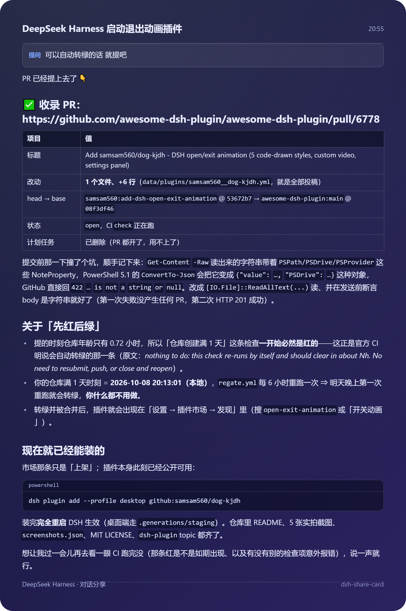
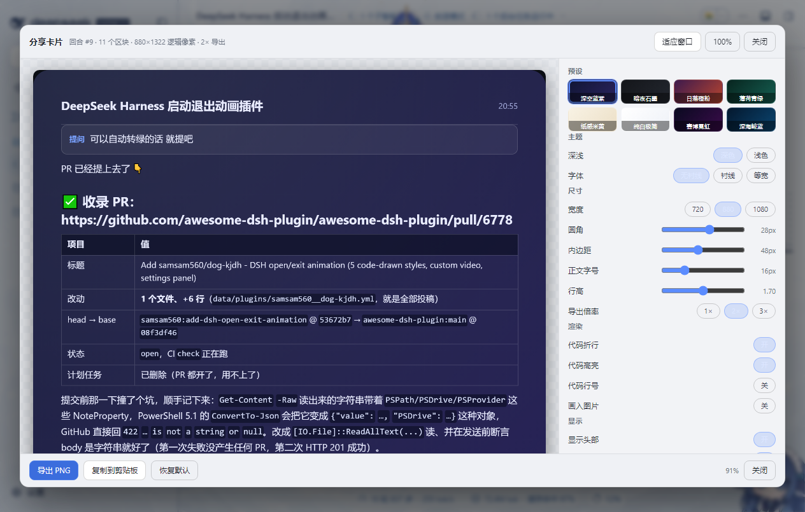
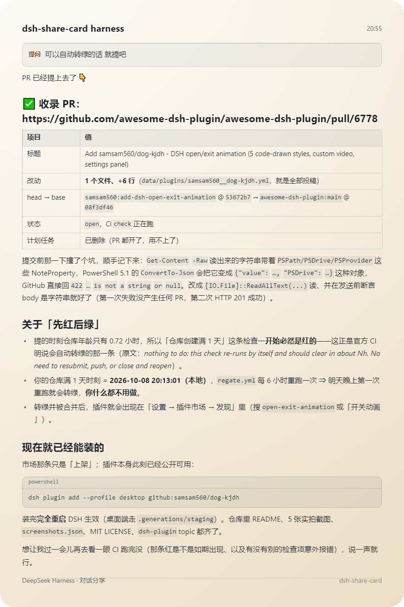
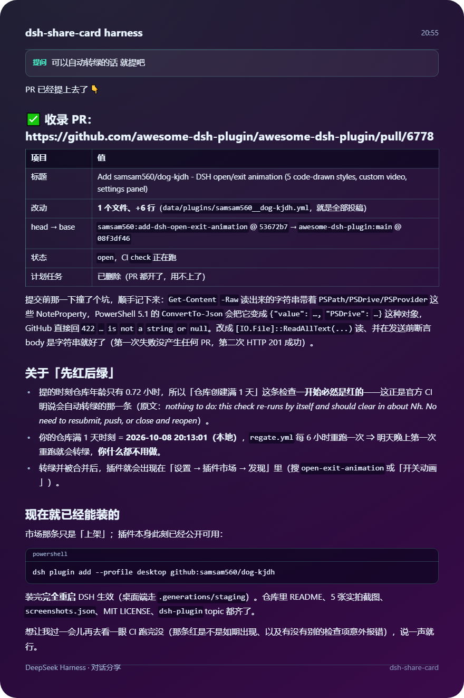

# dsh-share-card · 对话分享卡片

把 DeepSeek Harness 里的一段问答，一键变成可以发群的**精美分享卡片**（PNG）。
不截屏、不带界面皮肤和侧栏，而是把回答**重新排版**画出来：渐变背景、圆角、字体、配色、
代码块高亮都在卡片里，导出的图干净、清晰、可直接发微信 / 群聊 / 论坛。

> 纯前端实现：零第三方依赖、纯浏览器半插件（无需宿主服务）、**不联网、不上传任何内容**。



## 截图

| 工作台（在 DSH 里点「分享卡片」打开） | 纸感米黄 · 浅色 | 赛博霓虹 · 深色 |
| --- | --- | --- |
|  |  |  |

## 安装

```bash
dsh plugin add --profile desktop github:samsam560/chat-share-card
```

装完**完全重启 DSH** 生效（桌面端走 `.generations/staging`）。重启后在设置里能看到
「分享卡片」一栏。

## 用法

1. 把鼠标移到任意一条**已生成的回答**上 → 动作行里出现 **「分享卡片」** 按钮（和原生的
   「好的回答 / 有问题的回答」并排）。
2. 点它 → 打开**工作台浮层**：左边是实时预览，右边是全部参数，改哪一项预览立刻重画。
3. 满意后点 **导出 PNG**（文件名 `share-card-<时间戳>.png`）或 **复制到剪贴板** 直接粘贴进聊天窗口。
4. `Esc` 或点遮罩 / 「关闭」退出。

**设置 → 分享卡片** 里是同一套参数的常驻面板（改完自动保存在浏览器本地
`localStorage["dsh-share-card:config"]`，下次打开还是你的偏好）。

## 参数

| 参数 | 说明 | 默认 |
| --- | --- | --- |
| 预设 | 8 套渐变配色（见下） | 深空蓝紫 |
| 主题 | 深色 / 浅色（浅色系预设会自动用浅底深字） | 深色 |
| 字体 | 无衬线 / 衬线 / 等宽 | 无衬线 |
| 宽度 | 720 / 880 / 1080 逻辑像素 | 880 |
| 圆角 | 0–48 | 28 |
| 内边距 | 24–80 | 48 |
| 正文字号 | 14–22 | 16 |
| 行高 | 1.2–2.0 | 1.7 |
| 导出倍率 | 1× / 2× / 3×（2× 即 880 → 1760px 宽，发群足够清晰） | 2× |
| 代码折行 / 代码高亮 | 代码块是否折行、是否语法着色 | 开 / 开 |
| 代码行号 | 代码块左侧显示行号 | 关 |
| 画入图片 | 回答里的图片是否画进卡片（默认关闭，用 `[图片]` 占位以免画布被污染） | 关 |
| 显示头部 / 页脚 / 提问框 / 时间 / 水印 | 各区域的开关 | 全开 |
| 标题 / 页脚文字 / 提问标签 / 水印 | 自定义文案；标题留空时自动取会话标题 | — |

**8 套预设**：深空蓝紫 `deepseek`、暗夜石墨 `midnight`、日落橙粉 `sunset`、薄荷青绿 `mint`、
纸感米黄 `paper`、纯白极简 `snow`、赛博霓虹 `neon`、深海鲸蓝 `ocean`。

## 卡片里有什么

- **标题**（会话名或自定义）+ 右上角**时间**
- **提问**（可选，带「提问」标签的引用框）
- 回答正文：段落、**标题**、**有序 / 无序列表**（含嵌套）、**引用块**、**表格**（含表头与自动列宽）、
  **代码块**（语言名 + 语法高亮 + 可选行号）、行内 `代码`、**粗体 / 斜体 / 链接**、分割线
- **页脚**：自定义文案 + 水印

排版用 canvas 2D 逐块规划（先量再画、两遍布局），中日韩文字按字符断行、英文按词断行，
所以长回答不会被截成锯齿或溢出。

## 技术实现

- **入口**：注册在客户端插槽 `conversation.chat.assistant-actions`（`id: share-card`，`order: 55`）
  与 `settings.section`（`order: 620`）。
- **提取**：从被点击那条回答的**渲染 DOM** 读取结构化内容。DSH 聊天区是一列扁平的
  flow item，每个 item 自带 `data-chat-turn` 属性，同一回合的多行是兄弟节点而不是父子 ——
  所以提取顺序是：从按钮找到 `[data-turn-tail]` → 取回合号 → 全文档找该回合
  `[data-chat-flow-kind="assistant-step"][data-chat-group-part="response"]` 的最后一条非空回答行；
  推理（reasoning）行与工具调用行按 `data-chat-group-part` / flow-key 排除。
- **渲染**：纯数据模型 → 两遍布局（测量 → 绘制）→ `canvas` → `toBlob` / `toDataURL` 导出。
  没有任何 `html2canvas` 之类的依赖，也没有把 DOM 交给浏览器截图。
- **自动化接口**：`window.__dshShareCard = { version, config, set, reset, open, close, extractLast,
  render, extractAndRender, renderBlocks, presets, state }`，方便脚本化验证与二次开发。

## 已知限制

- DSH 的聊天区是**虚拟化列表**：很久以前、当前没有渲染在页面里的回合取不到内容；请
  先滚到那条回答可见再点「分享卡片」。
- 图片默认不画入卡片（用 `[图片]` 占位）——打开「画入图片」时，跨域图片可能让画布被污染，
  导致导出失败。
- 超长回答有高度防呆（极端情况会在卡片底部标注「内容过长已截断」）。

## 许可

MIT © 2026 samsam560

## 版本记录

- **0.1.0** — 首个版本：回答动作按钮 + 工作台浮层（实时预览 / 8 套预设 / 尺寸与排版参数 /
  显示开关）+ 导出 PNG / 复制剪贴板 + 设置页常驻面板 + `window.__dshShareCard` 自动化接口。
